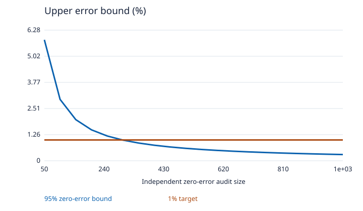
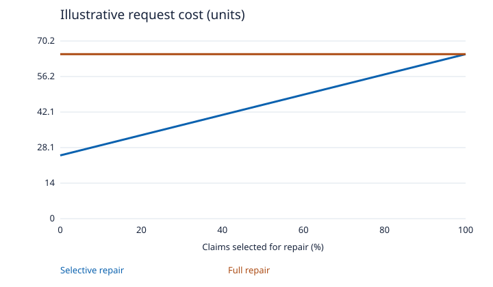
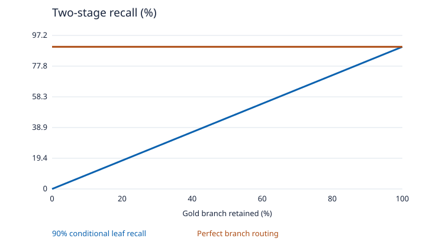
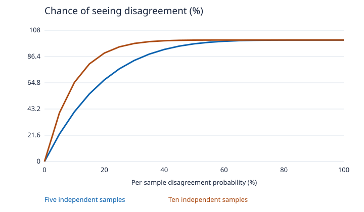
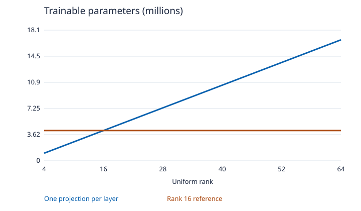
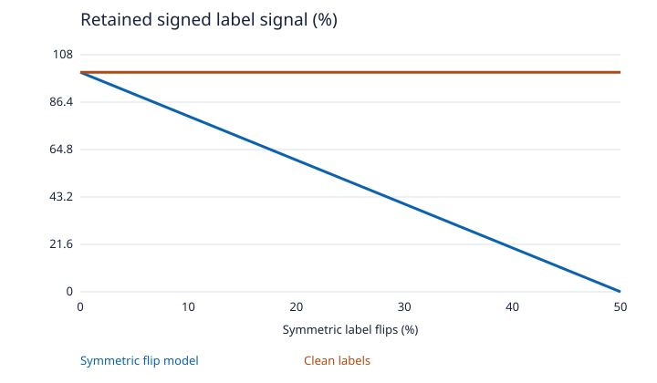
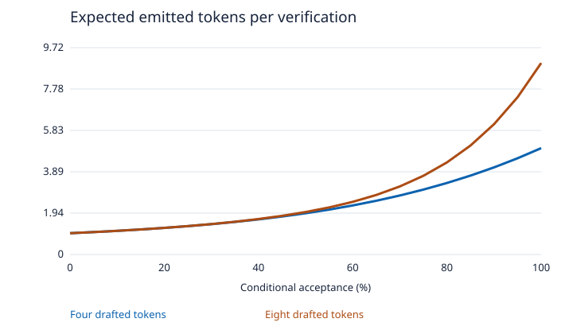
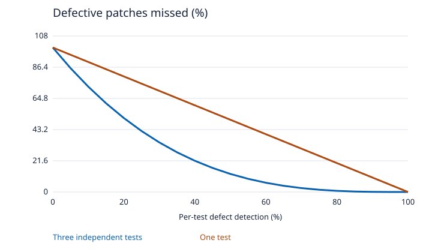
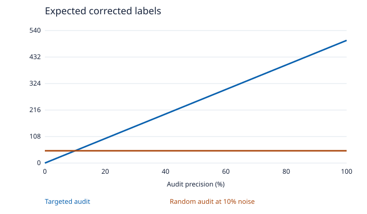
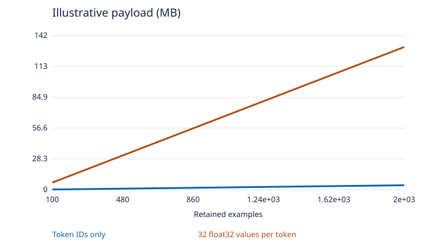

# AI wave · Analytical curves

Illustrative assumptions only. See [protocols](../PROTOCOLS_21_30.md) for the proposed experiments.

## 21. Calibrated abstention for document assistants

[CSV](21-ai.csv)

## 22. Claim-level repair of AI citations

[CSV](22-ai.csv)

## 23. Hierarchical retrieval with contextual leaf embeddings

[CSV](23-ai.csv)

## 24. Sampling until uncertainty stabilizes

[CSV](24-ai.csv)

## 25. Quantization-aware adapters under a fixed VRAM budget

[CSV](25-ai.csv)

## 26. Noise-aware preference training for multilingual assistants

[CSV](26-ai.csv)

## 27. Adaptive draft length for exact speculative decoding

[CSV](27-ai.csv)

## 28. Independent tests for AI-generated bug fixes

[CSV](28-ai.csv)

## 29. Data triage using training dynamics and influence

[CSV](29-ai.csv)

## 30. Small replay buffers for continual AI learning

[CSV](30-ai.csv)
