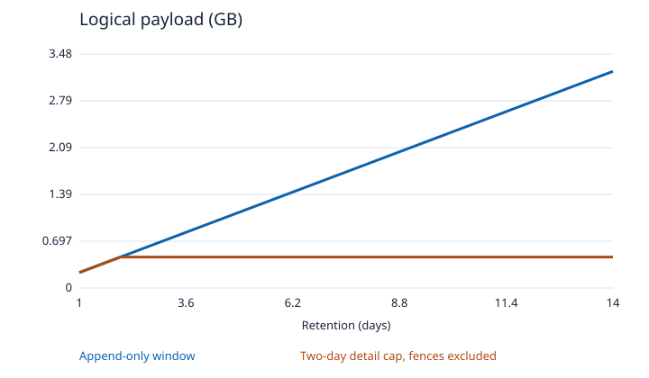
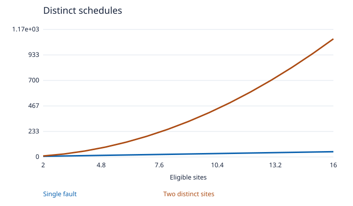
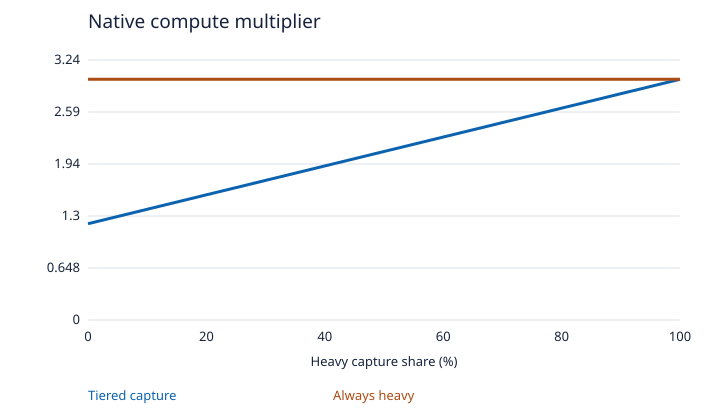
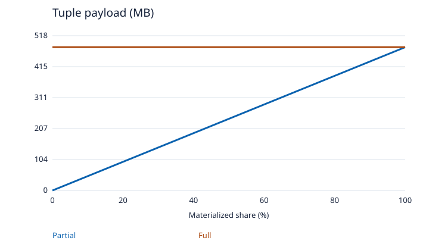
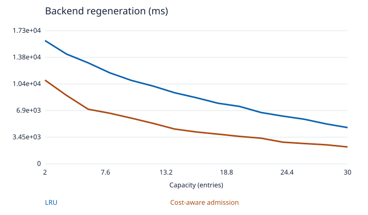
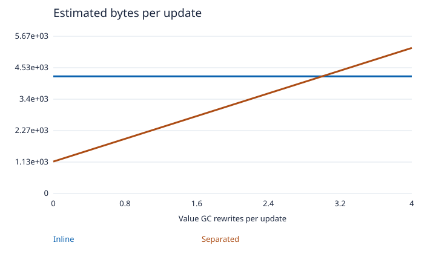
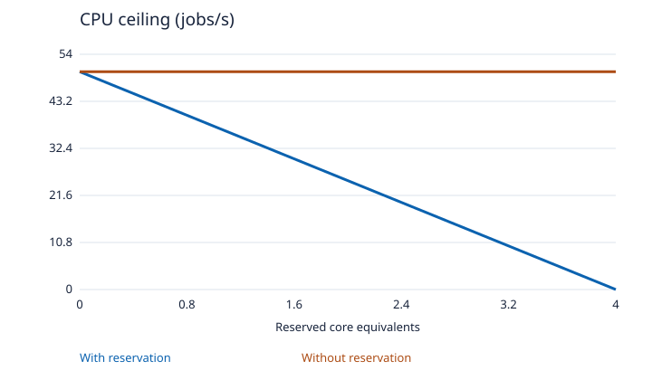
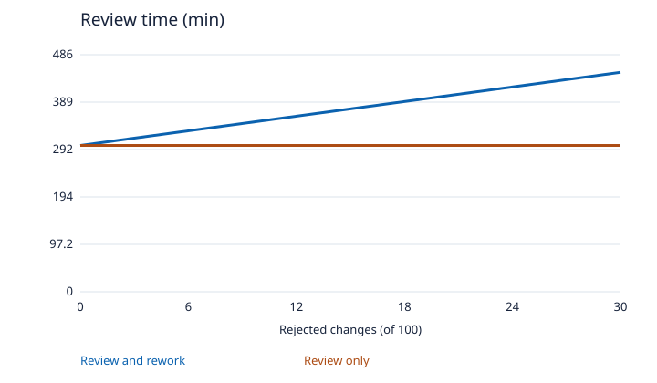
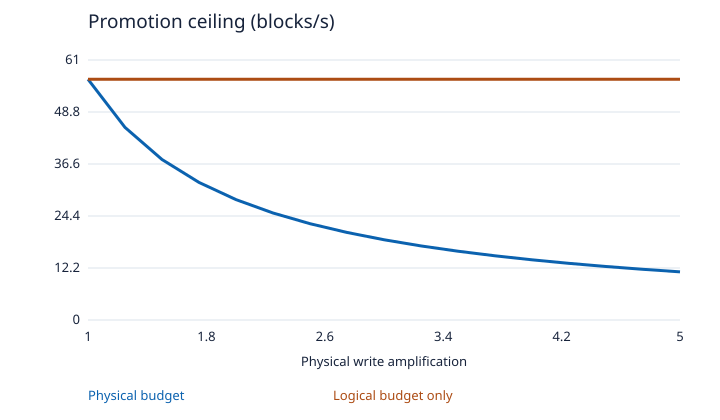
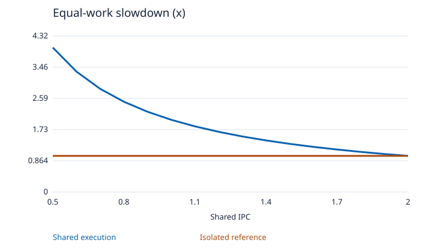

# Model curves

Analytical scenarios and seeded toy outputs.

## 01-ledger

[CSV data](01-ledger.csv)

## 02-faults

[CSV data](02-faults.csv)

## 03-replay

[CSV data](03-replay.csv)

## 04-views

[CSV data](04-views.csv)

## 05-cache

[CSV data](05-cache.csv)

## 06-compaction

[CSV data](06-compaction.csv)

## 07-workers

[CSV data](07-workers.csv)

## 08-php

[CSV data](08-php.csv)

## 09-ssd

[CSV data](09-ssd.csv)

## 10-prefetch

[CSV data](10-prefetch.csv)
