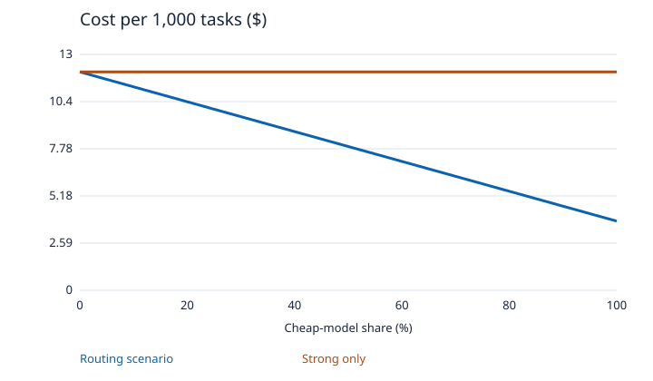
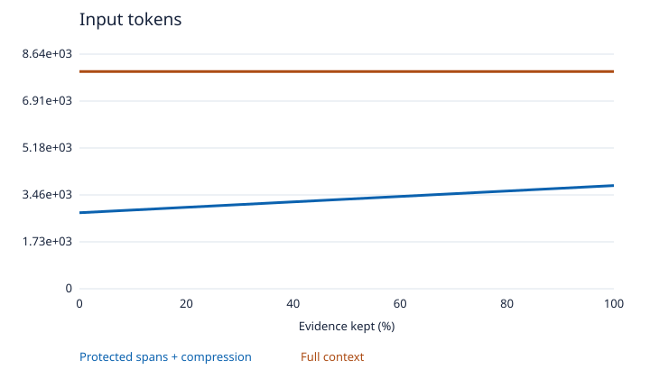
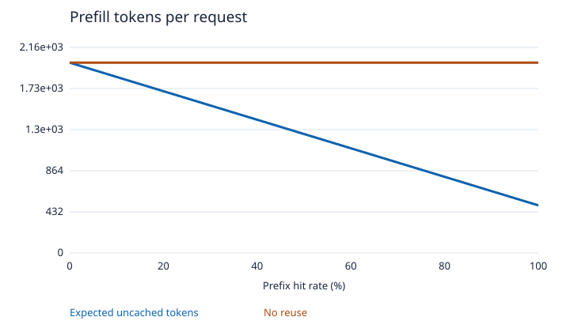
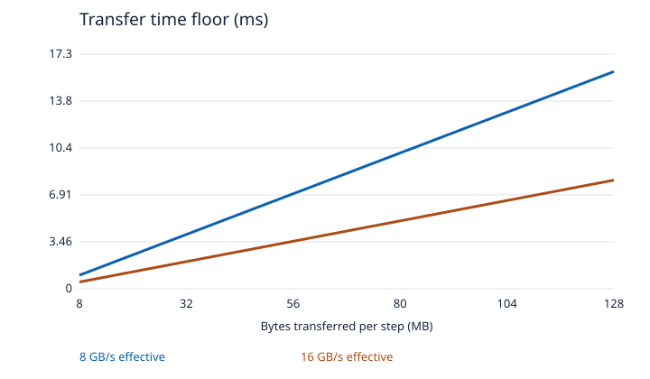
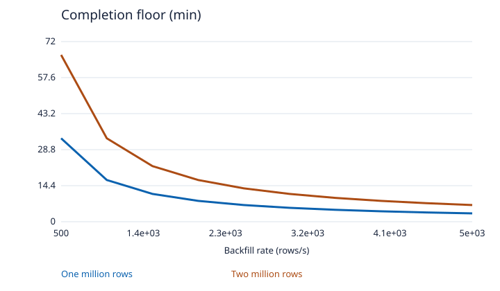
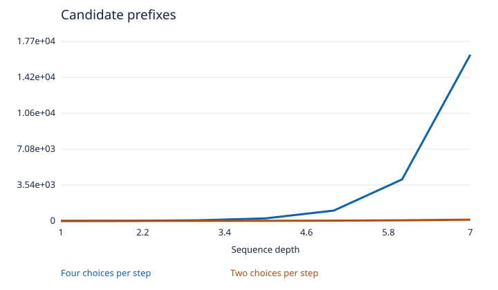
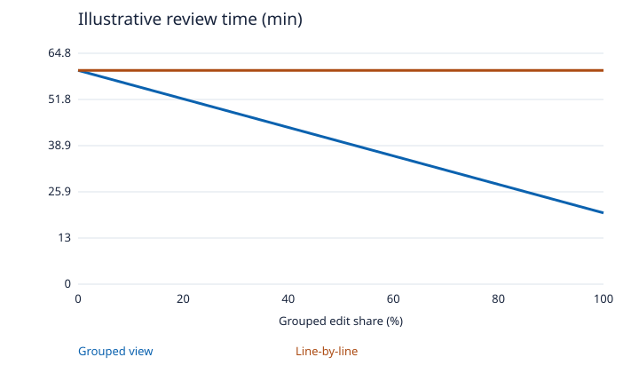
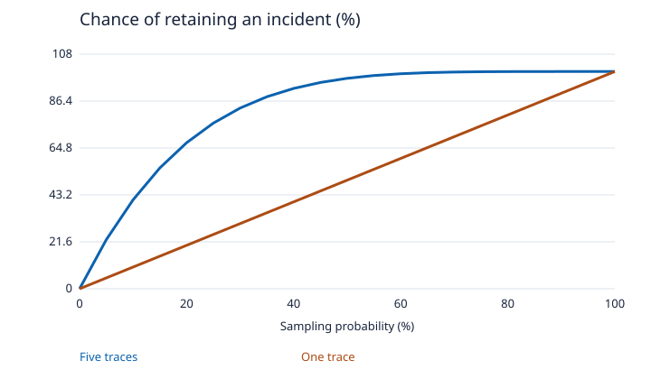
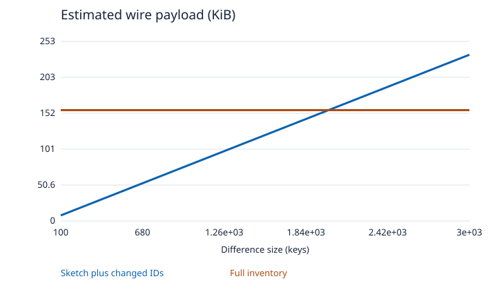
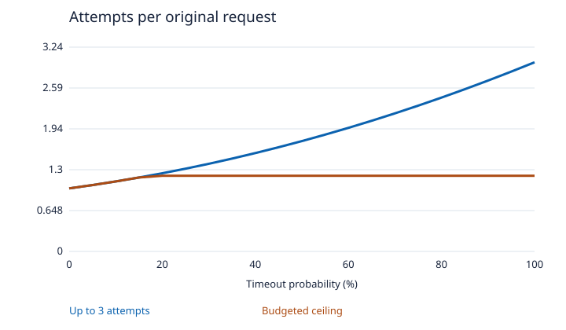

# Wave 2 model curves

Analytical scenarios with explicit assumptions.

## 11. Risk-calibrated LLM routing

Assumes $12 and $2 per thousand strong and cheap requests. Fifteen percent of cheap requests escalate.

[CSV data](11-routing.csv)

## 12. Evidence-preserving prompt compression

The 8,000-token context contains 1,000 evidence tokens and 7,000 background tokens. Background is compressed to 40%.

[CSV data](12-compression.csv)

## 13. Deadline-aware prefix reuse for local LLMs

A 2,000-token prompt has a reusable 1,500-token prefix. The figure omits cache management and queueing.

[CSV data](13-prefix.csv)

## 14. Latency-budgeted local model offload

Uses decimal units and models transfer-only time with no overlap or fixed overhead.

[CSV data](14-offload.csv)

## 15. Fault-tested rolling schema changes

Constant-rate floor with no lock contention, retries or maintenance windows.

[CSV data](15-migration.csv)

## 16. Change-directed stateful API fuzzing

Illustrative branching at exact depth. Dependencies, invalid states and equivalent sequences change actual search cost.

[CSV data](16-api-fuzz.csv)

## 17. Refactor-aware code review for PHP

Linear illustrative time allocation for a fixed edit workload. Human review time requires a study.

[CSV data](17-diff.csv)

## 18. Rare incident capture under a fixed telemetry budget

Independent uniform sampling model. Correlated decisions and tail policies need replay.

[CSV data](18-traces.csv)

## 19. Sketch-first reconciliation for offline replicas

Two 32-byte cells and a 16-byte identifier per difference are planning assumptions. Excludes record bodies and fallback.

[CSV data](19-reconcile.csv)

## 20. Retry budgets for metastable overload

Independent timeout scenario with at most two retries. The capped line is an offered-load bound, with no completion or recovery claim.

[CSV data](20-overload.csv)
